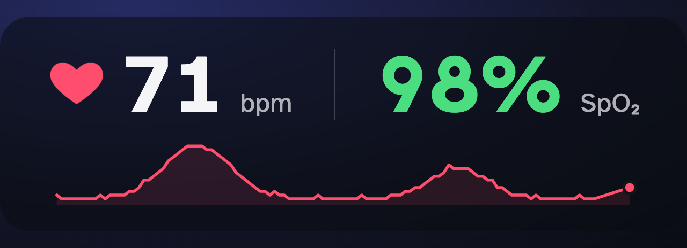

# Vital Sign

Live heart rate + SpO2 overlay for OBS, read directly from your own devices:
Viatom/Wellue rings and fingertip oximeters, any standard Bluetooth
heart-rate strap or pulse oximeter, and Apple Watch. No cloud service, no
account, no Pulsoid.

```text
ring / oximeter / strap --BLE------\
                                    bridge.py --WebSocket--> overlay.html (OBS Browser Source)
Apple Watch (HDS app) --your Wi-Fi-/
```

> This is a hobby project for putting vitals on a stream overlay, not a
> medical device or diagnostic tool. The devices it reads are
> consumer-grade, not clinical-grade -- don't use readings from this to
> make health decisions.



*Mockup with simulated readings, shown against a dark background for
contrast — `overlay.html`'s actual background is fully transparent, so in
OBS only the panel itself is visible over your stream/game.*

## Supported devices

| Device | `--source` | Shows | Status |
| --- | --- | --- | --- |
| Checkme O2 Max | `viatom` | HR + SpO2 | **Verified** on real hardware |
| O2Ring, Checkme O2, KidsO2, SleepU and other original-protocol Viatom/Wellue rings | `viatom` | HR + SpO2 | Same protocol as the O2 Max (per [`viatom-ble`](https://github.com/ecostech/viatom-ble)); untested here |
| O2Ring S, SleepHQ O2 Pro and other second-generation ("OxyII") Viatom rings | `oxyii` | HR + SpO2 | Built from published protocol notes and tested against simulated replies; untested on a real ring. Falls back to heart rate only if the ring ignores the live-data request |
| Viatom PC-60FW fingertip oximeter and OEM twins (OxySmart, ...) | `pc60` | HR + SpO2 | Decoder tested against frames captured from a real PC-60FW; untested on a device here |
| Pulse oximeters with the standard Bluetooth PLX service | `plx` | HR + SpO2 | Built from the Bluetooth spec; untested |
| Heart-rate straps and watches with the standard Bluetooth heart-rate service (Polar, Garmin HRM, Wahoo, Coospo, watches in "broadcast HR" mode...) | `hrs` | HR | Connection verified against the O2 Max's own heart-rate service |
| Apple Watch via an iPhone relay app (see [Apple Watch](#apple-watch)) | `hrs` | HR | Same code path as any heart-rate strap |
| Apple Watch via the Health Data Server app | `hds` | HR | Tested with simulated requests in the app's format |
| None (simulated readings) | `demo` | HR + SpO2 | For laying out the overlay without hardware |

Every Viatom ring also offers the standard heart-rate service, so `hrs`
works with them too (heart rate only). If you try a device that isn't
listed and it works, or a listed one that doesn't, an issue with what you
saw is genuinely useful -- this table only claims what has been confirmed.

Not sure what you have? `bridge.py --list-devices` scans and prints the
exact `--source` value for every supported device in range.

## Platform support

- **macOS** — **Verified** against a real Checkme O2 Max.
- **Windows 10/11** — Implemented (auto-discovery, `.ps1` start/stop scripts)
  but **not yet run against real hardware** — see the platform-specific notes
  throughout this README and the comments in `start_bridge.ps1`/`stop_bridge.ps1`.
- **Linux** — Untested, but Bleak (the Bluetooth library underneath) is well
  supported there, and `viatom-ble`'s primary development target is a
  Raspberry Pi — just use the `.sh` scripts and adjust the
  Bluetooth-permission step below.

If you test on Windows or Linux, opening an issue (or a PR) with what did or
didn't work is genuinely useful — this list reflects what's been confirmed,
not just what should theoretically work.

## Combining sources (fallbacks)

`--source` can be given more than once. Sources are used in the order you
list them, and **each number comes from the first source that has a live
value for it**. So:

```bash
python3 bridge.py --source viatom --source hds
```

shows heart rate and SpO2 from the ring while it's on your finger. If you
take it off, or it runs flat, the overlay switches to the watch's heart
rate within a couple of seconds and shows `--` for SpO2. It switches back
as soon as the ring has a reading again. "Live" means a reading within the
last 15 seconds (`--fresh-seconds`).

## Apple Watch

An Apple Watch can't stream SpO2 -- it only takes occasional background
spot checks -- so it supplies heart rate only. There are two ways to get
it to the bridge, neither involving Pulsoid:

1. **Health Data Server (HDS) app** -- `--source hds`. The watch app sends
   each reading straight to your computer over Wi-Fi. In the watch app,
   set the server to this computer's IP address (LAN or Tailscale) and port
   `3476`, then press start. This is the same thing the app's own desktop
   receiver ([hds_desktop](https://github.com/Rexios80/hds_desktop)) does;
   `bridge.py` replaces it. HDS is a paid watch app.
2. **An iPhone relay app** -- `--source hrs`. Apps such as ECHO, HeartCast or
   HR Broadcast make your iPhone pose as a standard Bluetooth heart-rate
   sensor, fed by the watch. Keep the relay app in the foreground when the
   bridge first connects: iOS limits what a backgrounded app can advertise.
   These are third-party apps; this project hasn't tested them individually.

HDS sends over the network, so `bridge.py` has to accept incoming
connections for it -- see [Security & privacy](#security--privacy) for what
that listener does and doesn't accept. On macOS, allow incoming
connections for Python if the firewall asks.

## How it works

- [`bridge.py`](bridge.py) runs every configured source at once and merges
  them ([`vitalsign/merge.py`](vitalsign/merge.py)). It re-broadcasts the
  result as JSON over a local WebSocket (`ws://localhost:8765`).
- Original-protocol Viatom rings go through
  [`viatom-ble`](https://github.com/ecostech/viatom-ble) (MIT, cross-platform
  via [Bleak](https://github.com/hbldh/bleak)), which polls the ring every 2
  seconds -- the path verified against a real Checkme O2 Max.
- Every other Bluetooth protocol shares one connect/reconnect loop in
  [`vitalsign/ble.py`](vitalsign/ble.py). The byte-level decoding for each
  lives in [`vitalsign/protocols.py`](vitalsign/protocols.py) and is
  unit-tested against captured or spec-defined frames (`tests/`).
- Discovery reads each device's advertisement to pick its protocol. Viatom
  rings of both generations advertise the same manufacturer ID and the
  standard heart-rate service but not which protocol they speak, so for
  those the bridge connects once briefly and checks which protocol service
  the ring actually has. (The original version of this check guessed from
  the advertisement alone and mistook a real O2 Max for a second-generation
  ring.)
- With no `--source`, `bridge.py` scans for exactly one supported device and
  uses it, so a one-device setup needs no configuration. If several are in
  range it keeps waiting and logs them, so you can pin one.
- [`overlay.html`](overlay.html) is a self-contained page (no external
  requests, no build step) that connects to that WebSocket and renders a
  beating heart icon + BPM + SpO2, with a transparent background sized for
  compositing in OBS. It fades out and shows a status line if the bridge
  disconnects or the device comes off. For heart-rate-only sources it shows
  `--` for SpO2.
- A BPM trend sparkline (last 5 minutes) sits below the numbers, entirely
  client-side — `bridge.py` doesn't buffer any history, `overlay.html` just
  keeps a rolling window of the same readings it already gets over the
  WebSocket. A freshly (re)loaded overlay starts with an empty graph and
  builds up over the next 5 minutes; nothing survives a reload. The window
  length lives in one constant (`TREND_WINDOW_MS`) if you want it longer
  or shorter.

## Setup

Needs Python 3.11 or newer.

**macOS / Linux:**

```bash
cd /path/to/vital-sign   # wherever you cloned this repo
python3 -m venv .venv
source .venv/bin/activate
pip install -r requirements.txt
```

On macOS, the first BLE scan will prompt for Bluetooth permission for your
terminal — grant it in *System Settings → Privacy & Security → Bluetooth*.
On Linux, add your user to the `bluetooth` group so BLE doesn't need `sudo`
(`sudo usermod -aG bluetooth $USER`, then log out and back in).

**Windows 10/11** (PowerShell; unverified against real hardware — see
[Platform support](#platform-support)):

```powershell
cd C:\path\to\vital-sign   # wherever you cloned this repo
python -m venv .venv
.venv\Scripts\Activate.ps1
pip install -r requirements.txt
```

If `Activate.ps1` refuses to run, PowerShell's default execution policy is
blocking it — see the execution-policy note in
[Automatic startup](#automatic-startup).

### 1. Run the bridge

**Make sure the device is NOT currently connected to its phone app**
(ViHealth, O2Insight_Pro, a fitness app...) — BLE only allows one active
connection, so quit/disconnect those apps first (fine, since you'd use
this for streaming, not overnight CPAP-sync sessions). Then, for a one-off
manual run (useful the first time, to watch the logs and confirm readings
look sane):

```bash
python3 bridge.py -v          # macOS/Linux
python bridge.py -v           # Windows
```

With no `--source`, it scans for a supported device and connects to it if
it's the only one in range — see it happen in the verbose log. To pick a
device, or to combine several, see what's in range and the exact value to
use for each:

```bash
python3 bridge.py --list-devices
python3 bridge.py --source viatom:<ADDRESS> --source hds   # e.g. ring + Apple Watch fallback
python3 bridge.py --source demo                          # no hardware: simulated readings
```

`python3 bridge.py --help` lists every source type. The older
`--address <ADDRESS>` still works and means `--source auto:<ADDRESS>`.

For everyday use, use the start/stop scripts instead (idempotent — safe to
call repeatedly, tracks their own PID, logs to `bridge.log`):

```bash
./start_bridge.sh   # macOS/Linux: launches bridge.py in the background if not already running
./stop_bridge.sh    # macOS/Linux: stops it if running; no-ops otherwise
```

```powershell
.\start_bridge.ps1  # Windows equivalents
.\stop_bridge.ps1
```

These are what the automatic-startup section below wires into OBS. If you
want specific sources (`SOURCES`), a pinned device, or a non-default port
for these scripts, copy `config.sh.example`/`config.ps1.example` to
`config.sh`/`config.ps1` and edit it — otherwise skip this, the defaults
(auto-discover, port 8765) just work.

### 2. Add the overlay to OBS

In OBS: **Sources → + → Browser Source**

- Check **Local file**, point it at the full path to `overlay.html` in
  wherever you cloned this repo
- Width/height: **`600x180`** is a reasonable starting box, but any size
  works — the whole overlay scales to fit whatever box you set (see
  "Customizing the overlay" below), so a smaller box just renders smaller
  rather than clipping, and a bigger one scales up to fill as much of it
  as it can without distorting proportions (an aspect ratio very
  different from the overlay's own will still leave some dead space on
  one axis — uniform scaling can't avoid that, only avoid clipping).
  Pick whatever reads well at your stream's actual resolution.
- Check **Shutdown source when not visible** OFF (so it keeps its WebSocket
  connection warm across scene switches)
- The background is transparent — no chroma key needed

Reload the browser source (right-click → *Interact*/*Refresh*) any time you
restart `bridge.py`.

## Automatic startup

Stock OBS has no "run a command when X happens" hook, so this uses the free
[Advanced Scene Switcher](https://obsproject.com/forum/resources/advanced-scene-switcher.395/)
plugin instead of an OBS Python script — it avoids matching OBS's embedded
Python version to a venv containing `bleak`/`websockets`, which is a common
source of "script failed to load" errors unrelated to your actual code.

Advanced Scene Switcher can trigger on more than just scene changes; pick
whichever condition actually matches when you want the device connected:

- **Streaming/Recording condition (recommended default)** — starts the
  bridge exactly when you go live or start recording, stops it when you
  stop, regardless of how many scenes you have or switch between. This is
  usually the better fit even if you *do* have multiple scenes, since you
  typically want the device connected for the whole stream, not just one
  particular scene.
- **Scene condition** — only if you specifically want the overlay/BLE
  connection tied to one particular scene rather than the whole
  stream/recording (e.g. it only makes sense during a "workout" scene, not
  during a "chatting" scene). Requires an actual scene *transition* to
  fire — if the overlay's scene is your only scene, or you never leave it,
  this condition never triggers, since there's nothing to transition
  from/to. Use the Streaming/Recording condition instead in that case.

**Install:**

You're about to bypass a Gatekeeper/SmartScreen warning below, so verify the
download first rather than trusting it blind — GitHub publishes a SHA256
digest for every release asset, so you have something concrete to check
against. Look it up with `--repo` (a bare `gh release view WarmUpTill/SceneSwitcher`
is wrong — that treats the repo name as a *tag* and fails):

```bash
gh release view --repo WarmUpTill/SceneSwitcher --json assets --jq '.assets[] | "\(.name): \(.digest)"'
```

Then hash the exact file you downloaded and compare it against the matching
line above (or the digest shown on the asset's own entry on the
[releases page](https://github.com/WarmUpTill/SceneSwitcher/releases)).
`gh release view` with no tag resolves to whatever is newest, so don't
hardcode a version number here either — it'll drift the moment a new
release ships. Use the literal filename you actually see in your
downloads folder, not a wildcard (which can silently match an old
download from a previous version instead):

```bash
shasum -a 256 ~/Downloads/advanced-scene-switcher-<version>-macos-universal.pkg      # macOS -- replace <version> with what you downloaded
Get-FileHash "$env:USERPROFILE\Downloads\advanced-scene-switcher-<version>-windows-x64-Installer.exe" -Algorithm SHA256  # Windows -- same
```

- macOS: download the `.pkg`, right-click it and choose *Open* to bypass
  Gatekeeper on an unnotarized installer, and follow the prompts.
- Windows: download the `-windows-x64-Installer.exe`, run it, and click
  *More info → Run anyway* if SmartScreen blocks it (same unnotarized-
  installer situation as macOS's Gatekeeper, different dialog).

Either way, restart OBS afterward — *Advanced Scene Switcher* will appear
under the **Tools** menu.

**Configure** (Tools → Advanced Scene Switcher → Macro tab):

1. **New macro** — name it e.g. `vital-sign`.
2. **Condition** — pick one:
   - *Streaming/Recording (recommended)*: add a **Streaming** condition,
     state = **Stream running**. If you also want it running for local
     recordings without streaming, add a **second condition** to the *same*
     macro — **Recording**, state = **Recording running** — and set its
     **Logic type** to **Or**, not the default And. This matters: with two
     *separate* macros instead (one per condition, each with its own Else
     Action), stopping the stream while a recording is still going would
     trigger that macro's Else Action and kill the bridge out from under the
     still-running recording, and vice versa. One macro with an Or means the
     Else Action (stop) only fires once *neither* is active.
   - *Scene*: add a **Scene** condition, set to the scene that contains your
     `overlay.html` browser source. Only do this instead of (not in addition
     to) the above if you specifically want it tied to one scene rather than
     the whole stream — see the note above on why this needs an actual scene
     transition to fire.
3. **Action** → add a **Run** action (System category) pointing at your
   start script (see platform notes below for the exact path/arguments).
4. **Else Action** → add a **Run** action pointing at your stop script the
   same way.

   (Advanced Scene Switcher runs the main actions while the condition is
   true and the "Else Actions" once it becomes false — so e.g. going live
   starts the bridge, ending the stream stops it.)
5. Set **"Perform actions:"** (near the top of the macro editor) to **"only
   when result changes"** — without it (i.e. left on "always"), the
   start/stop actions fire on every condition re-check instead of once per
   transition. (The scripts are idempotent either way, so this mostly just
   avoids log spam and unnecessary PID checks.) Confirmed against the
   installed plugin's own strings — this field has been renamed across
   versions, so if neither label matches what you see, look for whatever
   controls how often actions run relative to the condition's state.
6. Check the box to enable the macro, and hit **Start** in the General tab
   if the plugin isn't already running.

Exact field names may differ slightly by version — the "Run" action under
System is what you want.

**macOS Action (start) — use the wrapper app, not `start_bridge.sh` directly:**

- Path: `/usr/bin/open`
- Arguments: `-a "/path/to/vital-sign/VitalSignBridge.app"`

This is not optional cosmetics — pointing the Action directly at
`start_bridge.sh` will crash with a macOS privacy (TCC) error the moment it
tries to touch Bluetooth. When OBS spawns a Bluetooth-touching process as a
direct subprocess, macOS holds *OBS* responsible for that access, and
OBS.app's own `Info.plist` has no Bluetooth usage description — so instead
of prompting, macOS hard-crashes the process (you'll see `Responsible: OBS`
and `Namespace TCC` in the crash report if this happens). `VitalSignBridge.app`
is a minimal wrapper (tracked in this repo) with its own `Info.plist`
declaring Bluetooth usage; launching it via `open -a` makes it its own
independent process as far as macOS's privacy system is concerned, so its
own permission is what gets checked instead of OBS's. It just execs
`start_bridge.sh` — see `VitalSignBridge.app/Contents/MacOS/VitalSignBridge`.
Confirmed working end-to-end against a real running OBS instance (BLE
connect + the actual overlay browser source both came up clean).

**macOS Else Action (stop)** — `stop_bridge.sh` directly, full path, no
wrapper needed (stopping never touches Bluetooth, so TCC doesn't care who's
responsible for it).

**Linux path**: the full path to `start_bridge.sh`/`stop_bridge.sh`, no
arguments needed — the shebang line makes them directly executable, and
Linux doesn't have anything equivalent to the macOS TCC issue above.

**Windows path**: `.ps1` files aren't directly executable the way `.sh`
files are (no shebang-equivalent, and PowerShell's default execution policy
blocks scripts outright), so point the Run action at `powershell.exe`
itself and pass the script as an argument:

- If the Run action has one combined command-line field:
  `powershell.exe -ExecutionPolicy Bypass -File "C:\path\to\start_bridge.ps1"`
  (and the `stop_bridge.ps1` equivalent for the Else Action)
- If it has separate Path/Arguments fields: Path = `powershell.exe`,
  Arguments = `-ExecutionPolicy Bypass -File "C:\path\to\start_bridge.ps1"`

`-ExecutionPolicy Bypass` scopes to that single `powershell.exe` process —
it doesn't touch your system's persistent execution policy, so there's no
lasting change from using it here. That said, `Bypass` skips a real safety
check (it'll run *any* script unprompted), so only point it at a script
path you actually trust — fine for `start_bridge.ps1`/`stop_bridge.ps1` in
your own clone of this repo, not a pattern to reuse for arbitrary scripts.

Check `bridge.log` (and, on Windows, `bridge.out.log`) if the overlay
doesn't light up after the condition triggers — it'll show whether the BLE
connection attempt happened at all.

## Troubleshooting

- **Overlay stuck on "Bridge offline"**: `bridge.py` isn't running, or the
  port doesn't match — both default to `8765`.
- **"Connecting…" or "Waiting for device…" forever**: the device is
  probably still connected to its phone app (ViHealth, O2Insight_Pro...).
  Force-quit that app/disconnect Bluetooth from it. Viatom rings also only
  advertise for a short while after waking, so wake it (put it on, or press
  its button). `bridge.py` keeps retrying, so there's no need to restart it.
- **"Not worn" while the device is on**: it's the device's own report.
  On a Checkme O2 Max showing "Error 4" or a blinking sensor, that's a
  ring-sensor fault: the ring sensor or its cable needs replacing, not the
  wrist unit.
- **Readings look off (stuck at 0, or don't match the device's own display)**:
  run with `-v` and compare. For original-protocol Viatom rings the byte
  offsets live in the installed `viatom_ble/protocol.py` (`_IDX_SPO2` etc.);
  for everything else in [`vitalsign/protocols.py`](vitalsign/protocols.py).
  An issue with a verbose log is the fastest way to get a device's layout
  fixed.
- **Device battery draining fast while streaming**: expected — a held BLE
  connection keeps the radio active the whole session, same as the official
  app would. Viatom rings are disconnected after 5 minutes of "not worn" so
  they can power down.
- **"Several matching devices in range"** in the log: auto-discovery found
  more than one, so it waits rather than guess. Pin the one you want with
  `--source KIND:ADDRESS` (the log and `--list-devices` print it), or
  `SOURCES` in `config.sh`/`config.ps1`.
- **"has no oxyii service … try --source viatom:…"** (or similar): the
  `--source` type you forced doesn't match the device; use the one
  suggested.
- **Apple Watch (HDS) readings never arrive**: check the watch app's server
  address is this computer's current IP and port `3476`, that both are on
  the same network (or Tailscale), and that the firewall allows incoming
  connections for Python. `bridge.log` says "rejected a request from …" if
  a request arrived from an address outside your private network ranges;
  add that network with `--hds-allow CIDR` only if you know why it's there.
- **(Windows) `start_bridge.ps1` does nothing / "running scripts is
  disabled"**: PowerShell's execution policy is blocking it. Run it directly
  via `powershell.exe -ExecutionPolicy Bypass -File start_bridge.ps1` to
  confirm that's the cause — see the execution-policy note above for the
  permanent fix when wiring it into Advanced Scene Switcher.
- **(Windows) `bridge.log` looks empty after a run**: check
  `bridge.out.log` too — Start-Process splits stdout/stderr into separate
  files there, and both get overwritten (not appended) on every start,
  unlike the `.sh` scripts.
- **(macOS) OBS/Python crashes with a "Namespace TCC" / privacy error
  mentioning `NSBluetoothAlwaysUsageDescription` and `Responsible: OBS`**:
  you've pointed Advanced Scene Switcher's Action directly at
  `start_bridge.sh` instead of the `VitalSignBridge.app` wrapper — see the
  macOS Action instructions above for why that specific combination
  (OBS as parent, no wrapper) always crashes on Bluetooth access, and isn't
  something a code fix on our end can work around.
- **Overlay shows "Bridge offline" specifically inside OBS, but a plain
  browser tab pointed at the same `overlay.html` connects fine**: check
  `bridge.log` for `InvalidOrigin` — OBS's embedded browser can send a
  different `Origin` header for local-file sources than a regular browser
  does (this happened once already; see the `ALLOWED_ORIGINS` comment in
  `bridge.py`). `ALLOWED_ORIGINS` is a real access control, not just a
  compatibility shim, so don't add a rejected origin to it reflexively —
  confirm it's actually your own OBS instance's local-file rendering (a
  `file://`-style or `http://absolute`-style value, not an arbitrary
  `http(s)://` origin), and never add a wildcard.

## Customizing the overlay

`overlay.html` is a single file — edit the CSS variables at the top
(`--hr-color`, `--spo2-good/warn/bad`) or the layout directly. No build step;
just refresh the OBS browser source after saving.

Everything (the panel and the status pill) lives inside `#stage`, which
`rescaleStage()` scales and centers as one unit to fit whatever OBS
Browser Source box you set — computed as `min(window width / stage's
natural width, window height / stage's natural height)`, so it shrinks to
fit a small box and grows to fill a large one without distorting
proportions or clipping either way. "Natural size" here accounts for
`.status`'s out-of-flow overhang below `.panel` (see its CSS comment),
not just `.panel` itself — otherwise a height-constrained box could scale
`.panel` to fill 100% of the available height and push the status pill
below it entirely outside the viewport. This replaced an
earlier fix for the same underlying clipping problem (anchoring the
panel to one side so overflow only ever cut into the low-priority SpO2
label, never the heart/HR — see the git history on this section if
you're curious) — scaling to fit is strictly better since nothing
overflows in the first place, and it fixed a second bug for free: the
status pill used to be centered against the *viewport* independently of
the panel, so the two drifted apart whenever the panel wasn't centered.
`.hr-trend-line`/`.hr-trend-dot` deliberately don't use
`vector-effect="non-scaling-stroke"` for the same reason — the line
weight should scale up/down with everything else, not stay a fixed
2 screen-pixels regardless of box size.

If you resize the ring icon, fonts, or padding, you don't need to touch
the scaling logic at all — `rescaleStage()` measures `#stage`'s natural
size dynamically (via a `ResizeObserver` on both `.panel` and the status
pill, since either one changing size can change the natural size) rather
than assuming a fixed reference size, so it keeps working from whatever
the CSS actually produces.

To remove the BPM trend graph entirely: delete the `.trend-row` div from
the HTML and the `resizeTrendViewBox()`/`setInterval(drawTrend, ...)` calls
near the bottom of the script. `drawTrend`/`resizeTrendViewBox` have no
visible effect without the DOM elements they target (they return early),
and `recordHr` keeps recording into memory regardless either way — both
are harmless left in place, but there's no reason to leave the dead calls
in if you're not using the graph.
To change the window length, edit `TREND_WINDOW_MS` (currently 5 minutes).

## Security & privacy

- **Nothing leaves your machine.** `bridge.py` binds its WebSocket server to
  `localhost` only — it's never reachable from your network, let alone the
  internet. There's no cloud service, account, or API key involved anywhere
  in this project.
- **The HDS listener is the one network-facing part, and only when you ask
  for it** (`--source hds`). It listens on port 3476 on all interfaces,
  because the watch reaches your computer over Wi-Fi or Tailscale. It only
  accepts requests from private address ranges (LAN, link-local, Tailscale
  — see `DEFAULT_ALLOWED_NETWORKS` in [`vitalsign/hds.py`](vitalsign/hds.py)),
  so a public IPv6 address doesn't expose it to the internet. It only takes
  small heart-rate messages (anything over 4 KB is refused) and never sends
  readings back. It refuses anything a web page could send (only `PUT`, and
  nothing carrying a browser `Origin` header), so a site open in your
  browser can't post fake numbers to it. HDS itself has no authentication,
  so a device on your own network *could* send fake heart-rate numbers to
  your overlay; it can't read anything.
- **Auto-discovery trusts what's in range.** Bluetooth heart-rate and
  oximeter devices aren't paired or authenticated, so with plain `auto`
  (or `hrs` with no address) a device someone else advertises nearby could
  be picked up. For streaming somewhere public, pin your own device with
  `KIND:ADDRESS` (`--list-devices` prints it).
- **The WebSocket also checks the `Origin` header**, restricted to what
  `overlay.html` actually sends when loaded as a local file — both `null`
  (what a generic browser sends for `file://`) and `http://absolute` (what
  OBS's embedded browser sends for local-file browser sources specifically
  — confirmed against a real running OBS instance) — plus no-Origin-header
  clients (plain scripts/CLI tools). This stops an unrelated webpage open in
  a regular browser tab from quietly opening a WebSocket to this port and
  reading your live vitals in the background — see the `ALLOWED_ORIGINS`
  comment in `bridge.py`.
- **What's excluded from git** (see `.gitignore`): `config.sh`/`config.ps1`
  (contain your device's BLE address — a device identifier, not a secret, but
  no reason to publish it), `bridge.log`/`bridge.out.log` (may contain
  historical readings), and `.bridge.pid`. Only the `.example` templates
  are tracked.
- **BLE pairing**: connecting means the device briefly can't be reached by
  its own app (BLE allows one central connection at a time). No pairing
  credentials are stored beyond what Bleak needs to maintain the connection
  for that session. Second-generation Viatom rings are read without their
  authentication handshake; the bridge only ever sends the live-values
  request, never commands that change settings or read recorded files.
- If you fork this and add your own integrations (e.g. pushing to a cloud
  service), audit what you're sending — heart rate and SpO2 are health data
  even in a casual streaming context.

## Accessibility

`overlay.html` doesn't rely on color alone to signal SpO2 severity — low
readings get a small ▲/⚠ marker badge next to the number, in addition to
the color change, so the state is legible without color perception. The
heartbeat pulse animation respects
`prefers-reduced-motion`. `aria-live` regions and labels are included for
the (secondary) case of opening the file directly in a browser tab rather
than through OBS, which renders to video and isn't accessible to assistive
tech regardless of the page's own markup. The BPM trend sparkline is
`aria-hidden` — it's a supplementary view of the same number already
announced live, and no meaningful trend can be read aloud from a shape
usefully anyway; the current BPM value carries the information.

## Credits

- [`viatom-ble`](https://github.com/ecostech/viatom-ble) (MIT) — the
  reverse-engineered Viatom/Wellue BLE protocol and client this project is
  built on.
- [Bleak](https://github.com/hbldh/bleak) (MIT) — the cross-platform BLE
  library everything here uses under the hood.
- Protocol research that the other decoders are written from (no code
  copied): [SomnoTrace](https://github.com/ilyakruchinin/SomnoTrace)'s
  O2Ring S / OxyII notes, [sza2/viatom_pc60fw](https://github.com/sza2/viatom_pc60fw)'s
  PC-60FW packet notes, and the PC-60FW frames captured in
  [pedasmith/BluetoothDeviceController](https://github.com/pedasmith/BluetoothDeviceController)
  that the PC-60 tests use.
- [Health Data Server](https://github.com/Rexios80/hds_overlay) — the watch
  app whose local-network message format the `hds` source accepts.
- [Advanced Scene Switcher](https://github.com/WarmUpTill/SceneSwitcher) —
  the OBS plugin used for scene-triggered automation.

## License

[MIT](LICENSE).
